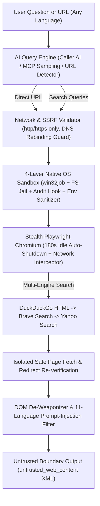

<a id="top"></a>

<div align="center">

# 🛡️ Weber MCP

### **Ultra-Secure, AI-Driven, Sandboxed Playwright Web Search & URL Inspection MCP Server**

*API-Key-Free • Multi-Engine Headless Chromium • 4-Layer Native OS Sandbox • 11-Language Prompt-Injection Defense*

<p>
  <a href="./LICENSE"></a>
  
  
  
  
  
</p>

---

### 🌐 Select Language / Dil Seçin

[🇬🇧 **ENGLISH (Always Open)**](#lang-en) • [🇹🇷 **TÜRKÇE**](#lang-tr) • [🇩🇪 **DEUTSCH**](#lang-de) • [🇫🇷 **FRANÇAIS**](#lang-fr) • [🇸🇦 **العربية**](#lang-ar) • [🇷🇺 **РУССКИЙ**](#lang-ru) • [🇨🇳 **中文**](#lang-zh) • [🇯🇵 **日本語**](#lang-ja) • [🇮🇱 **עברית**](#lang-he) • [🇮🇷 **فارسی**](#lang-fa)

<sub>Click any language above to jump to and open its localized section below. English documentation stays permanently open.</sub>

</div>

---

<a id="lang-en"></a>

## 🇬🇧 English Documentation

**Weber MCP** is a Python **MCP (Model Context Protocol)** server built for AI assistants (Claude, Antigravity, Cursor, Windsurf, etc.) that need **API-key-free**, real-time web search and safe URL inspection powered by **Playwright Headless Chromium** inside a **4-layer native OS/process sandbox**.

> [!TIP]
> **Smart AI Search:** Instead of sending raw conversational questions straight to a search bar, Weber MCP lets the calling AI (or MCP Sampling) rewrite the user's intent in their native language into 2–4 high-signal search queries — while automatically handling direct URLs in one unified flow.

---

### 🧠 1. AI-Driven Universal Query Architecture (`weber_mcp/query_engine.py`)

Rather than maintaining fragile hardcoded grammar tables per language, **Weber MCP** uses AI natively across **all languages** (`en`, `tr`, `ar`, `de`, `fr`, `es`, `it`, `pt`, `ru`, `ja`, `ko`, `zh`, `he`, `fa`, and more):

1. **Caller AI Query Generation (`search_queries`):** The AI invoking `weber_search` analyzes the user's question in its original language and passes 2–4 sharp search queries (`search_queries`), `intent`, `extracted_entity`, and `intent_keywords`.
   - 🇹🇷 **Turkish:** `"Metro Exodus oyunu ne hakkındaydı?"` → `["Metro Exodus oyununun hikayesi", "Metro Exodus Hikayesi", "Metro Exodus oyun konusu"]`
   - 🇬🇧 **English:** `"What was the Metro Exodus game about?"` → `["Metro Exodus game story", "Metro Exodus Story", "Metro Exodus plot summary"]`
   - 🇸🇦 **Arabic:** `"عن ماذا تتحدث لعبة Metro Exodus؟"` → `["قصة لعبة Metro Exodus", "قصة Metro Exodus", "Metro Exodus القصة والملخص"]`
2. **MCP Sampling Fallback (`sampling/createMessage`):** If only a raw question is provided and the MCP client supports Sampling, Weber MCP sends a `create_message` request to the connected AI to return a structured JSON `QueryPlan`.
3. **Direct URL Detection & Raw Fallback:** Automatically detects explicit or bare-domain URLs for immediate safe fetching, and cleanly strips global Unicode punctuation (`?`, `¿`, `؟`, `？`, `。`, etc.) in offline CLI fallback mode.

---

### 🏗️ 2. Security & Execution Architecture



---

### 🛡️ 3. Multi-Layer Security & Sandbox Matrix

| Layer | Module | Protection Mechanisms | Status |
| :--- | :--- | :--- | :---: |
| **SSRF & Network Isolation** | `weber_mcp/security.py` | Allows `http`/`https` only; blocks `file://`, `javascript:`, `data:`, `ftp://`; blocks loopback (`127.0.0.0/8`, `::1`), private IPv4/IPv6, Cloud Metadata (`169.254.0.0/16`), CGNAT (`100.64.0.0/10`), obfuscated IPs (`0x7f000001`, `2130706433`), dangerous extensions (`.exe`, `.msi`, `.zip`, `.ps1`, etc.), embedded credentials; validates DNS before & after redirects; sliding-window rate limiter (`30 req / 60s`). | ✅ Active |
| **Stealth Headless Chromium** | `weber_mcp/browser.py` | Isolated contexts (`accept_downloads=False`, `service_workers="block"`, `permissions=[]`); **180-second idle auto-shutdown** (`chrome.exe` + Playwright `node.exe` stop cleanly on inactivity and wake on demand); anti-bot fingerprint normalization (`--enable-automation` removed, `navigator.webdriver`, `plugins`, `window.chrome`, WebGL, `Sec-CH-UA`); real-time `page.route` subrequest blocker; strict **no-CAPTCHA-bypass** policy. | ✅ Active |
| **DOM & Prompt-Injection Guard** | `weber_mcp/sanitizer.py` | Strips `script`, `style`, `iframe`, `object`, `svg`, `form`, HTML comments, and visually hidden DOM nodes (`display:none`, `visibility:hidden`, `opacity:0`, `font-size:0/1px`, `aria-hidden="true"`); removes zero-width/bidi Unicode characters; redacts Indirect Prompt Injections across **11 languages** (`en`, `tr`, `ar`, `de`, `fr`, `es`, `ru`, `zh`, `ja`, `he`, `fa`); wraps output in `<untrusted_web_content>`. | ✅ Active |
| **Native OS/Process Sandbox** | `weber_mcp/sandbox.py` | **Windows Kernel Job Object (`win32job`):** `2048 MB` RAM ceiling, `32` max active processes, `KILL_ON_JOB_CLOSE`, UI & clipboard isolation (`READCLIPBOARD`, `WRITECLIPBOARD`, etc.); **Ephemeral Filesystem Jail** wiped on exit; **C-level `sys.addaudithook`** blocking unauthorized `subprocess.Popen`, `os.system`, `.ssh`/`.aws`/`winreg` access; **Environment Sanitization** stripping `*KEY*`, `*TOKEN*`, `*SECRET*`, `*PASSWORD*`. | ✅ Active |

> [!IMPORTANT]
> External web pages are inherently untrusted. Weber MCP wraps every fetched payload inside `<untrusted_web_content source="..." trust_score="...">...</untrusted_web_content>` and computes a `trust_score` (`0–100`) based on HTTPS usage, hidden DOM elements stripped, and prompt-injection patterns detected.

---

### 🧰 4. MCP Tools Reference

| Tool Name | Purpose | Key Parameters |
| :--- | :--- | :--- |
| **`weber_search`** | AI-powered multi-engine search + optional deep page extraction, or direct URL fetch | `query`, `search_queries`, `intent`, `extracted_entity`, `intent_keywords`, `max_results`, `deep_fetch`, `deep_fetch_count`, `language` |
| **`weber_fetch_url`** | Safely visit a specific URL in sandboxed Playwright Chromium and return sanitized text | `url`, `wait_for_selector`, `max_chars`, `extract_links` |
| **`weber_transform_query`** | Resolve a structured `QueryPlan` JSON via Caller AI, MCP Sampling, or URL detection | `question`, `search_queries`, `intent`, `extracted_entity`, `intent_keywords`, `language` |
| **`weber_security_audit_url`** | Audit any URL for SSRF, obfuscated IP, scheme, extension, and DNS safety without opening a browser | `url` |
| **`weber_sandbox_status`** | Inspect live 4-layer OS/Process Sandbox metrics and 180s browser lifecycle state | *(none)* |

---

### 🚀 5. Quick Start, Diagnostics & Client Setup

```powershell
# 1. Install dependencies
cd c:\Users\ahmet\Downloads\Weber-MCP
python -m pip install -r requirements.txt

# (If Chromium binary is not installed yet)
python -m playwright install chromium

# 2. Start the MCP server over stdio
python server.py
# or:
python -m weber_mcp.server

# 3. Run local CLI diagnostics
python server.py --test-query "Metro Exodus oyunu ne hakkındaydı?"
python server.py --test-url "https://example.com"
python server.py --test-sandbox

# 4. Run the full automated test suite
python -m pytest -v
```

For Claude Desktop, Antigravity, or Cursor integration, see [`mcp_config.example.json`](./mcp_config.example.json).

---

### 📄 6. License

This project is licensed under the **Apache License 2.0** — see the [`LICENSE`](./LICENSE) file for full terms and conditions.

---

## 🌍 Localized Documentation (Click Any Language to Expand)

<details>
<summary><strong>🇹🇷 Türkçe Dokümantasyon (Açmak/kapatmak için tıklayın)</strong></summary>

<a id="lang-tr"></a>

### Genel Bakış

**Weber MCP**, yapay zekâ asistanlarının (Claude, Antigravity, Cursor vb.) **API anahtarı gerektirmeden** Playwright headless Chromium kullanarak internette yüksek güvenlikli arama yapmasını ve kullanıcı tarafından verilen URL'leri güvenli şekilde okumasını sağlayan bir Python **MCP (Model Context Protocol)** sunucusudur.

#### 1. Yapay Zekâ Tabanlı Evrensel Sorgu Mimarisi (`weber_mcp/query_engine.py`)
Her dil için ayrı sabit regex tabloları yazmak yerine sorgu zekâsını **tüm dillerde** doğrudan yapay zekâya bırakır:

1. **Çağıran AI Sorgu Üretimi (`search_queries`):** `weber_search` aracını çağıran AI asistanı, kullanıcının sorusunu kendi dilinde analiz ederek 2–4 adet keskin arama sorgusu (`search_queries`), `intent`, `extracted_entity` ve `intent_keywords` üretir:
   - **Türkçe:** `"Metro Exodus oyunu ne hakkındaydı?"` -> `["Metro Exodus oyununun hikayesi", "Metro Exodus Hikayesi", "Metro Exodus oyun konusu"]`
   - **İngilizce:** `"What was the Metro Exodus game about?"` -> `["Metro Exodus game story", "Metro Exodus Story"]`
   - **Arapça:** `"عن ماذا تتحدث لعبة Metro Exodus؟"` -> `["قصة لعبة Metro Exodus", "قصة Metro Exodus"]`
2. **MCP Sampling Desteği (`sampling/createMessage`):** Yalnızca ham soru gönderildiğinde ve istemci MCP Sampling desteklediğinde bağlı AI'dan yapılandırılmış `QueryPlan` JSON'ı ister.
3. **Doğrudan URL Tespiti & Evrensel Geri Dönüş:** Metindeki URL'leri otomatik tespit edip güvenli açar; offline CLI çağrılarında Unicode noktalama temizliği yapar.

#### 2. Çok Katmanlı Güvenlik & Yerleşik OS/Process Sandbox

1. **SSRF & Ağ İzolasyonu (`weber_mcp/security.py`):** Yalnızca `http://` ve `https://` izinli; loopback/özel IP/Cloud Metadata/CGNAT/gizli IP engelli; yönlendirme sonrası **DNS Rebinding** doğrulamalı; 60 saniyede en fazla 30 istek hız sınırlayıcılı.
2. **Sertleştirilmiş Playwright Headless Chromium (`weber_mcp/browser.py`):** Dosya indirme/Service Worker/izinler kapalı; **180 saniye boşta otomatik kapanma**; `--enable-automation` kaldırma + `navigator.webdriver`, `plugins`, `window.chrome`, WebGL ve `Sec-CH-UA` anti-bot normalizasyonu; **DuckDuckGo HTML**, **Brave Search** ve **Yahoo Search** desteği; CAPTCHA tespitinde güvenli durdurma.
3. **DOM Temizliği & Çok Dilli Prompt Injection Koruması (`weber_mcp/sanitizer.py`):** Tehlikeli etiketler, gizli DOM öğeleri ve 11 dilde (İngilizce, Türkçe, Arapça, Almanca, Fransızca, İspanyolca, Rusça, Çince, Japonca, İbranice, Farsça) *Indirect Prompt Injection* kalıpları temizlenir; çıktı `<untrusted_web_content>` sınırına alınır.
4. **4 Katmanlı Yerleşik OS & Process Sandbox (`weber_mcp/sandbox.py`):** Windows Kernel Job Object (`2048 MB` RAM, `32` süreç limiti, `KILL_ON_JOB_CLOSE`, pano/UI izolasyonu), geçici dosya sistemi kafesi, C-seviyesi `sys.addaudithook` süreç/kayıt defteri/kimlik dosyası engeli ve ortam değişkeni temizliği.

#### 3. Araçlar, Kurulum, Testler & Lisans

- **Araçlar:** `weber_search`, `weber_fetch_url`, `weber_transform_query`, `weber_security_audit_url`, `weber_sandbox_status`
- **Lisans:** **Apache License 2.0** ([`LICENSE`](./LICENSE))

```powershell
cd c:\Users\ahmet\Downloads\Weber-MCP
python -m pip install -r requirements.txt
python server.py
python server.py --test-sandbox
python -m pytest -v
```

[⬆️ Dil Menüsüne Dön](#top)

</details>

<details>
<summary><strong>🇩🇪 Deutsche Dokumentation / German (Zum Auf-/Zuklappen klicken)</strong></summary>

<a id="lang-de"></a>

### Überblick

**Weber MCP** ist ein extrem sicherer, sandbox-isolierter Python-**MCP-Server (Model Context Protocol)**, mit dem KI-Assistenten **ohne API-Schlüssel** über Playwright Headless Chromium Websuchen durchführen und direkte URLs sicher inspizieren können.

1. **KI-gestützte Sucharchitektur (`weber_mcp/query_engine.py`):** Die aufrufende KI generiert 2–4 präzise Suchbegriffe (`search_queries`) in jeder Sprache (z. B. `"Worum geht es in dem Spiel Metro Exodus?"` -> `["Metro Exodus Handlung und Geschichte", "Metro Exodus Geschichte"]`), ergänzt durch MCP Sampling (`sampling/createMessage`) und direkte URL-Erkennung.
2. **SSRF- & DNS-Rebinding-Schutz (`weber_mcp/security.py`):** Nur `http`/`https`, Blockierung lokaler/privater IPs, Cloud-Metadaten, gefährlicher Dateierweiterungen und Rate-Limiting (`30 / 60s`).
3. **Gehärtetes Playwright Chromium (`weber_mcp/browser.py`):** **Automatisches Beenden nach 180 Sekunden Inaktivität**, Anti-Bot-Fingerabdruck-Normalisierung (`navigator.webdriver`, `plugins`, `window.chrome`, WebGL, `Sec-CH-UA`), **DuckDuckGo HTML**, **Brave** & **Yahoo**, sofortiger Stopp bei CAPTCHAs.
4. **DOM-Bereinigung & 4-Schichten-OS-Sandbox (`weber_mcp/sanitizer.py`, `weber_mcp/sandbox.py`):** Entfernt versteckte Elemente & Prompt-Injections in 11 Sprachen (`<untrusted_web_content>`); Windows Job Object (`2048 MB` RAM, max. `32` Prozesse, Zwischenablage-/UI-Isolation), Dateisystem-Gefängnis, `sys.addaudithook` und Umgebungsvariablen-Bereinigung.
5. **Lizenz:** **Apache License 2.0** ([`LICENSE`](./LICENSE))

```powershell
cd c:\Users\ahmet\Downloads\Weber-MCP
python -m pip install -r requirements.txt
python server.py
python server.py --test-sandbox
python -m pytest -v
```

[⬆️ Zurück zum Sprachmenü](#top)

</details>

<details>
<summary><strong>🇫🇷 Documentation en français / French (Cliquer pour ouvrir/fermer)</strong></summary>

<a id="lang-fr"></a>

### Aperçu

**Weber MCP** est un serveur Python **MCP (Model Context Protocol)** ultra-sécurisé et isolé en sandbox permettant aux assistants IA d'effectuer des recherches web **sans clé API** et d'inspecter des URL via Playwright Headless Chromium.

1. **Architecture de requête pilotée par l'IA (`weber_mcp/query_engine.py`) :** L'IA appelante fournit 2 à 4 requêtes ciblées (`search_queries`) dans n'importe quelle langue (ex. `"De quoi parle le jeu Metro Exodus ?"` -> `["Metro Exodus histoire et résumé", "Histoire de Metro Exodus"]`), avec repli MCP Sampling (`sampling/createMessage`) et détection directe d'URL.
2. **Isolation SSRF & DNS Rebinding (`weber_mcp/security.py`) :** Uniquement `http`/`https`, blocage des IP privées/locales/Cloud Metadata et extensions dangereuses, contrôle DNS avant/après redirection (`30 req / 60s`).
3. **Playwright Chromium durci (`weber_mcp/browser.py`) :** **Extinction automatique après 180 secondes d'inactivité**, normalisation anti-bot (`navigator.webdriver`, `plugins`, `window.chrome`, WebGL, `Sec-CH-UA`), **DuckDuckGo HTML**, **Brave** & **Yahoo**, arrêt strict face aux CAPTCHA.
4. **Assainissement DOM & Sandbox à 4 couches (`weber_mcp/sanitizer.py`, `weber_mcp/sandbox.py`) :** Suppression des éléments cachés et injections multilingues (11 langues, balise `<untrusted_web_content>`) ; Windows Job Object (`2048 Mo` RAM, `32` processus max, isolation presse-papiers/UI), prison temporaire, `sys.addaudithook` et purge des variables secrètes.
5. **Licence :** **Apache License 2.0** ([`LICENSE`](./LICENSE))

```powershell
cd c:\Users\ahmet\Downloads\Weber-MCP
python -m pip install -r requirements.txt
python server.py
python server.py --test-sandbox
python -m pytest -v
```

[⬆️ Retour au menu des langues](#top)

</details>

<details>
<summary><strong>🇸🇦 التوثيق بالعربية / Arabic Documentation (انقر للفتح أو الإغلاق)</strong></summary>

<a id="lang-ar"></a>

### نظرة عامة

**Weber MCP** هو خادم **MCP (Model Context Protocol)** مكتوب بلغة Python يمكّن مساعدات الذكاء الاصطناعي من إجراء عمليات بحث آمنة على الإنترنت وفحص الروابط مباشرةً باستخدام **Playwright Headless Chromium** **دون الحاجة إلى أي مفتاح API**.

1. **محرك الاستعلامات المعتمد على الذكاء الاصطناعي (`weber_mcp/query_engine.py`):** يحلّل الذكاء الاصطناعي سؤال المستخدم بلغته الأصلية ويمرر 2–4 استعلامات بحث دقيقة في `search_queries` (مثل `"عن ماذا تتحدث لعبة Metro Exodus؟"` ← `["قصة لعبة Metro Exodus", "قصة Metro Exodus"]`) مع دعم **MCP Sampling** واكتشاف الروابط المباشرة.
2. **الحماية من SSRF وDNS Rebinding (`weber_mcp/security.py`):** يسمح فقط بـ `http/https`، ويحظر الشبكات المحلية والخاصة وبيانات السحابة الوصفية والامتدادات الخطرة مع محدّد معدل (30 طلباً/60 ثانية).
3. **متصفح Playwright المحصّن (`weber_mcp/browser.py`):** إغلاق تلقائي بعد **180 ثانية** من الخمول، تطبيع بصمة المتصفح لمكافحة كشف البوتات (`navigator.webdriver`, `plugins`, `window.chrome`, WebGL, `Sec-CH-UA`)، دعم **DuckDuckGo HTML** و**Brave** و**Yahoo**، والتوقف التلقائي عند CAPTCHA.
4. **تنظيف DOM وبيئة العزل ذات 4 طبقات (`weber_mcp/sanitizer.py`, `weber_mcp/sandbox.py`):** إزالة العناصر المخفية وحقن الأوامر بـ 11 لغة داخل `<untrusted_web_content>`، مع Windows Job Object (`2048 MB`، `32` عملية، عزل الحافظة)، وسجن الملفات المؤقتة، و`sys.addaudithook`، وتنقية متغيرات البيئة.
5. **الترخيص:** **Apache License 2.0** ([`LICENSE`](./LICENSE))

```powershell
cd c:\Users\ahmet\Downloads\Weber-MCP
python -m pip install -r requirements.txt
python server.py
python server.py --test-sandbox
python -m pytest -v
```

[⬆️ العودة إلى قائمة اللغات](#top)

</details>

<details>
<summary><strong>🇷🇺 Документация на русском / Russian (Нажмите, чтобы развернуть/свернуть)</strong></summary>

<a id="lang-ru"></a>

### Обзор

**Weber MCP** — это высокозащищённый Python-сервер **MCP (Model Context Protocol)** с изоляцией в песочнице, позволяющий ИИ-ассистентам выполнять веб-поиск **без API-ключей** и безопасно открывать URL-адреса через Playwright Headless Chromium.

1. **Универсальная ИИ-архитектура запросов (`weber_mcp/query_engine.py`):** Вызывающий ИИ формирует 2–4 точных поисковых запроса (`search_queries`) на языке пользователя (например, `"О чем игра Metro Exodus?"` -> `["Metro Exodus сюжет и история", "Metro Exodus сюжет"]`), с поддержкой **MCP Sampling** и автоопределением URL.
2. **Защита от SSRF и DNS Rebinding (`weber_mcp/security.py`):** Разрешены только `http`/`https`, блокировка локальных/приватных IP, облачных метаданных и опасных расширений, лимит 30 запросов в 60 секунд.
3. **Усиленный Playwright Chromium (`weber_mcp/browser.py`):** **Автоматическое закрытие через 180 секунд простоя**, антибот-нормализация (`navigator.webdriver`, `plugins`, `window.chrome`, WebGL, `Sec-CH-UA`), **DuckDuckGo HTML**, **Brave** и **Yahoo**, немедленная остановка при CAPTCHA.
4. **Очистка DOM и 4-слойная песочница (`weber_mcp/sanitizer.py`, `weber_mcp/sandbox.py`):** Удаление скрытых элементов и Prompt Injection на 11 языках (`<untrusted_web_content>`), Windows Job Object (`2048 MB`, до `32` процессов, изоляция буфера обмена/UI), изолированный каталог, `sys.addaudithook` и очистка секретных переменных среды.
5. **Лицензия:** **Apache License 2.0** ([`LICENSE`](./LICENSE))

```powershell
cd c:\Users\ahmet\Downloads\Weber-MCP
python -m pip install -r requirements.txt
python server.py
python server.py --test-sandbox
python -m pytest -v
```

[⬆️ Назад к выбору языка](#top)

</details>

<details>
<summary><strong>🇨🇳 中文文档 / Chinese (点击展开或折叠)</strong></summary>

<a id="lang-zh"></a>

### 概述

**Weber MCP** 是一个基于 Python 的高安全性 **MCP (Model Context Protocol)** 服务器，支持 AI 助手在**无需 API 密钥**的情况下，通过沙盒隔离的 Playwright Headless Chromium 执行联网搜索并安全抓取指定网页。

1. **AI 驱动的通用查询架构 (`weber_mcp/query_engine.py`)：** 由调用方 AI 生成 2–4 个精准搜索词传入 `search_queries`（例如 `"Metro Exodus 游戏讲的是什么？"` -> `["Metro Exodus 剧情 故事", "Metro Exodus 故事简介"]`），并支持 **MCP Sampling** 回退与直接 URL 识别。
2. **SSRF 与 DNS 重绑定防护 (`weber_mcp/security.py`)：** 仅允许 `http`/`https`，拦截本地/内网 IP、云元数据与危险文件扩展名，支持 60 秒 30 次限流。
3. **加固版 Playwright Chromium (`weber_mcp/browser.py`)：** **空闲 180 秒自动关闭浏览器**，反检测指纹规范化（`navigator.webdriver`、`plugins`、`window.chrome`、WebGL、`Sec-CH-UA`），支持 **DuckDuckGo HTML**、**Brave** 与 **Yahoo**，遇 CAPTCHA 立即停止。
4. **DOM 净化与 4 层原生沙盒 (`weber_mcp/sanitizer.py`, `weber_mcp/sandbox.py`)：** 清除隐藏 DOM 与 11 种语言的提示词注入并用 `<untrusted_web_content>` 隔离；Windows Job Object（`2048 MB` 内存、最多 `32` 进程、剪贴板/UI 隔离）、临时文件沙盒、`sys.addaudithook` 与环境变量脱敏。
5. **开源协议：** **Apache License 2.0** ([`LICENSE`](./LICENSE))

```powershell
cd c:\Users\ahmet\Downloads\Weber-MCP
python -m pip install -r requirements.txt
python server.py
python server.py --test-sandbox
python -m pytest -v
```

[⬆️ 返回语言菜单](#top)

</details>

<details>
<summary><strong>🇯🇵 日本語ドキュメント / Japanese (クリックして展開・折りたたみ)</strong></summary>

<a id="lang-ja"></a>

### 概要

**Weber MCP** は、AI アシスタントが **API キー不要** で Playwright Headless Chromium を使い、厳格なサンドボックス内で安全な Web 検索と URL 取得を行える Python 製 **MCP (Model Context Protocol)** サーバーです。

1. **AI 主導のユニバーサルクエリ設計 (`weber_mcp/query_engine.py`)：** 呼び出し元 AI が原語で 2〜4 個の検索クエリ (`search_queries`) を生成（例：`"Metro Exodus とはどんなゲーム？"` -> `["Metro Exodus ストーリー あらすじ", "Metro Exodus 物語 内容"]`）。**MCP Sampling** と直接 URL 検出にも対応。
2. **SSRF・DNS リバインディング対策 (`weber_mcp/security.py`)：** `http`/`https` のみ許可、ローカル/プライベート IP・クラウドメタデータ・危険な拡張子を遮断、レート制限（60 秒最大 30 回）。
3. **強化済み Playwright Chromium (`weber_mcp/browser.py`)：** **180 秒の無通信で自動終了**、アンチボット指紋正規化（`navigator.webdriver`, `plugins`, `window.chrome`, WebGL, `Sec-CH-UA`）、**DuckDuckGo HTML** / **Brave** / **Yahoo** 対応、CAPTCHA 検出時は即停止。
4. **DOM 無害化＆4 層 OS サンドボックス (`weber_mcp/sanitizer.py`, `weber_mcp/sandbox.py`)：** 非表示要素と 11 言語のプロンプトインジェクションを除去し `<untrusted_web_content>` で隔離。Windows Job Object（`2048 MB`、最大 `32` プロセス、クリップボード・UI 隔離）、一時ファイル隔離、`sys.addaudithook`、機密環境変数の除去。
5. **ライセンス：** **Apache License 2.0** ([`LICENSE`](./LICENSE))

```powershell
cd c:\Users\ahmet\Downloads\Weber-MCP
python -m pip install -r requirements.txt
python server.py
python server.py --test-sandbox
python -m pytest -v
```

[⬆️ 言語メニューに戻る](#top)

</details>

<details>
<summary><strong>🇮🇱 תיעוד בעברית / Hebrew Documentation (לחץ לפתיחה/סגירה)</strong></summary>

<a id="lang-he"></a>

### סקירה כללית

**Weber MCP** הוא שרת **MCP (Model Context Protocol)** בפייתון המאפשר לעוזרי AI לבצע חיפושים מאובטחים באינטרנט ולסרוק כתובות URL ישירות באמצעות **Playwright Headless Chromium**, **ללא צורך במפתח API** ותחת בידוד מלא (Sandbox).

1. **מנוע שאילתות אוניברסלי מונחה-AI (`weber_mcp/query_engine.py`):** ה-AI הקורא מייצר 2–4 שאילתות חיפוש מדויקות (`search_queries`) בכל שפה, עם תמיכה ב-**MCP Sampling** וזיהוי URL ישיר.
2. **הגנת SSRF ו-DNS Rebinding (`weber_mcp/security.py`):** מתיר `http`/`https` בלבד, חוסם כתובות פנימיות/מטא-דאטה/סיומות מסוכנות ומגביל קצב (30 בקשות / 60 שניות).
3. **דפדפן Playwright מוקשח (`weber_mcp/browser.py`):** **כיבוי אוטומטי לאחר 180 שניות של חוסר פעילות**, נרמול טביעת אצבע נגד בוטים (`navigator.webdriver`, `plugins`, `window.chrome`, WebGL, `Sec-CH-UA`), תמיכה ב-**DuckDuckGo HTML**, **Brave** ו-**Yahoo**, ועצירה מיידית ב-CAPTCHA.
4. **ניקוי DOM ו-Sandbox בן 4 שכבות (`weber_mcp/sanitizer.py`, `weber_mcp/sandbox.py`):** מסיר אלמנטים מוסתרים והזרקות פרומפט ב-11 שפות (`<untrusted_web_content>`), כולל Windows Job Object (`2048 MB`, עד `32` תהליכים, בידוד לוח), כלוב קבצים זמני, `sys.addaudithook` וניקוי משתני סביבה רגישים.
5. **רישיון:** **Apache License 2.0** ([`LICENSE`](./LICENSE))

```powershell
cd c:\Users\ahmet\Downloads\Weber-MCP
python -m pip install -r requirements.txt
python server.py
python server.py --test-sandbox
python -m pytest -v
```

[⬆️ חזרה לתפריט השפות](#top)

</details>

<details>
<summary><strong>🇮🇷 مستندات فارسی / Persian Documentation (برای باز/بستن کلیک کنید)</strong></summary>

<a id="lang-fa"></a>

### معرفی

**Weber MCP** یک سرور **MCP (Model Context Protocol)** به زبان پایتون است که به دستیارهای هوش مصنوعی امکان می‌دهد **بدون نیاز به کلید API**، با استفاده از **Playwright Headless Chromium** در محیط ایزوله (Sandbox) به جستجوی امن اینترنتی و بررسی مستقیم نشانی‌های وب بپردازند.

1. **مנוע پرس‌وجوی هوشمند مبتنی بر هوش مصنوعی (`weber_mcp/query_engine.py`):** هوش مصنوعی فراخوان ۲ تا ۴ عبارت جستجوی دقیق (`search_queries`) به زبان کاربر ارسال می‌کند و از **MCP Sampling** و تشخیص مستقیم URL نیز پشتیبانی می‌شود.
2. **محافظت SSRF و DNS Rebinding (`weber_mcp/security.py`):** تنها `http`/`https` مجاز است، IPهای محلی/خصوصی، متادیتای ابری و پسوندهای خطرناک مسدود می‌شوند (محدودیت ۳۰ درخواست در ۶۰ ثانیه).
3. **مرورگر Playwright ایمن‌سازی‌شده (`weber_mcp/browser.py`):** **خاموش شدن خودکار پس از ۱۸۰ ثانیه بیکاری**، عادی‌سازی اثر انگشت ضد ربات (`navigator.webdriver`, `plugins`, `window.chrome`, WebGL, `Sec-CH-UA`)، پشتیبانی از **DuckDuckGo HTML**، **Brave** و **Yahoo**، و توقف فوری هنگام CAPTCHA.
4. **پاک‌سازی DOM و Sandbox چهارلایه (`weber_mcp/sanitizer.py`, `weber_mcp/sandbox.py`):** حذف عناصر پنهان و تزریق دستور به ۱۱ زبان در قالب `<untrusted_web_content>`، همراه با Windows Job Object (`2048 MB`، حداکثر `32` پردازه، جداسازی کلیپ‌بورد)، قفس فایل موقت، `sys.addaudithook` و پاک‌سازی متغیرهای محیطی حساس.
5. **مجوز (License):** **Apache License 2.0** ([`LICENSE`](./LICENSE))

```powershell
cd c:\Users\ahmet\Downloads\Weber-MCP
python -m pip install -r requirements.txt
python server.py
python server.py --test-sandbox
python -m pytest -v
```

[⬆️ بازگشت به منوی زبان‌ها](#top)

</details>
